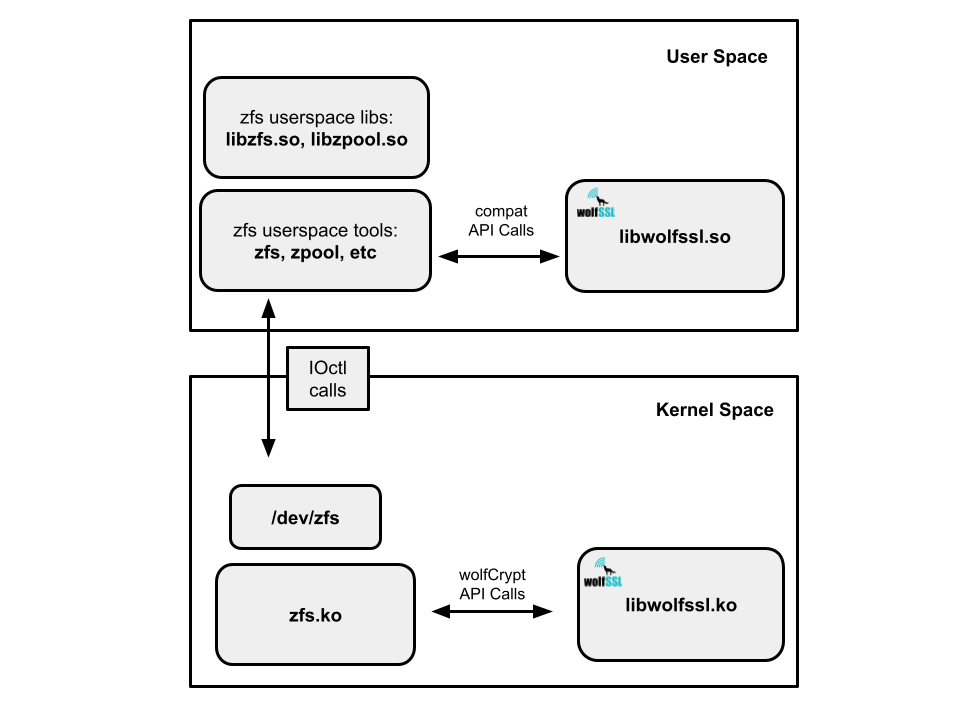

## Description

This project contains a patch for OpenZFS (https://github.com/openzfs/zfs)
that replaces its native crypto implementation (used on linux) with wolfCrypt
API calls. It links against `libwolfssl.so` and `libwolfssl.ko` in user and
kernel space.

The patch was written for the OpenZFS `zfs-2.4.2` release tag:
```
commit 6330a45b... (tag: zfs-2.4.2)   # annotated tag object 59f46c50 -> this commit
```
This patch inserts only a modest line count for wolfCrypt API calls,
while removing zfs internal crypto implementations:
```
$ git diff --stat | tail -n1
 41 files changed, 1056 insertions(+), 28442 deletions(-)
```

### Patch layout (per distro / version)

The wolfCrypt routing itself is distro-agnostic, but the source tree it applies
onto is not: each distribution and version ships OpenZFS with its own packaging
patches, so the wolfZFS patch is kept per target under `patches/<distro>/`:

```
patches/
  debian/   zfs-2.4.2_wolfzfs.patch        # upstream OpenZFS zfs-2.4.2 tag (reference)
  proxmox/  zfs-2.4.2-pve1_wolfzfs.patch   # Proxmox VE zfs-2.4.2-pve1 package
```

The `debian/` patch is the reference port, generated against the upstream
`zfs-2.4.2` release tag. Pick the file that matches the ZFS source you are
patching (see the "Build wolfZFS" step below).

At `2.4.2` these two files are byte-identical. All three trees — the upstream
`zfs-2.4.2` tag, Debian's `zfs-linux 2.4.2-1~bpo13+1`, and Proxmox's
`zfs-2.4.2-pve1` — share the same OpenZFS 2.4.2 base (the annotated `zfs-2.4.2`
tag, commit `6330a45b`); the distro packages add their own `debian/patches`
(Debian 16, Proxmox 10) on top. None of those packaging patches touch any of the
41 files the wolfZFS patch modifies, so the port applies to each with zero fuzz,
verified with `git apply --check` against each reconstructed source tree. The
files are kept separate because they are expected to diverge as distros and
versions advance — newer ZFS is already in flight (Proxmox `zfs-2.4.3-pve1`;
Debian `2.4.3-1` in testing/unstable, with `2.4.2-1~bpo13+1` still in
trixie-backports), and divergence will first appear whenever a distro's
packaging or an upstream refactor touches one of the files this patch modifies.

In addition to the ICP routing, this revision folds in the FIPS-related fixes
(previously proposed in PR #341, which this supersedes):
- `module/zfs/hkdf.c`: `PRIVATE_KEY_UNLOCK` bracket fixes
  `FIPS_PRIVATE_KEY_LOCKED_E` (-287) on encrypted dataset creation under
  wolfCrypt FIPS.
- RNG: key, salt, and IV material use the kernel's native `random_get_bytes()`,
  which is the wolfCrypt FIPS DRBG when the CRNG kernel patch is installed. The
  only change vs vanilla ZFS is upgrading the two GCM-IV sites in `zio_crypt.c`
  (`zio_crypt_key_wrap`, `zio_crypt_generate_iv`) from `random_get_pseudo_bytes`
  to `random_get_bytes`, so the IVs come from the approved DRBG (SP 800-38D
  requires GCM IVs from an approved RBG; the xorshift pseudo-RNG is not approved).
- Userspace key-derivation uses the provider-native `EVP_KDF "PBKDF2"` with a
  `RAND_bytes` salt, so it routes through an OpenSSL 3.x provider.
- `MODULE_IMPORT_NS("WOLFSSL")` is quoted for kernel >= 6.13.

### AES-GCM and SHA-512/256 compatibility

When `WOLFSSL_AESGCM_STREAM` is enabled, AES-GCM retains the streaming
wolfCrypt calls. When it is disabled, including FIPS v5 configurations that
exclude streaming, the adapter buffers the atomic operation and uses
`wc_AesGcmSetExtIV()` plus `wc_AesGcmEncrypt_ex()` for encryption and
`wc_AesGcmDecrypt()` for decryption. These names resolve to FIPS wrappers in
the licensed v5 headers. The adapter preserves the ZFS ciphertext/tag layout
and caller-supplied IV, and releases plaintext only after authentication
succeeds. This adaptation does not require enabling streaming or editing the
wolfCrypt module source.

ZFS `checksum=sha512` uses SHA-512/256. When wolfCrypt defines
`WOLFSSL_NOSHA512_256`, the adapter retains the OpenZFS generic implementation
for this checksum and emits a kernel notice when it is first used. That
checksum implementation is outside the wolfCrypt FIPS module boundary. When
wolfCrypt provides SHA-512/256, the checksum continues to use wolfCrypt.

The compatibility paths require LinuxKM build and end-to-end encrypted ZFS
verification with the intended commercial bundle and kernel before deployment.
Calling FIPS wrappers does not by itself establish approved-service status or
coverage of the operating environment; those depend on the applicable module
security policy and deployment configuration.



### License
The `ZFS_META_LICENSE` conflicts with the GPL-only libwolfssl.ko symbols
in a GPL build, causing modpost to fail. To resolve the conflict, either:
  1. obtain commercial licensing, or
  2. comment out the license, and use this for educational purposes only.

See:
- `module/os/linux/zfs/zfs_ioctl_os.c`

This project is a demonstration and not intended for production use as is.

## Prereq

This was done with Debian 13 netinst iso from here:
https://www.debian.org/CD/netinst/

The default install options were used for everything. You must set up a normal
user, and a root user. Root access is required to bootstrap sudoers access
later.

After install:
```
uname -a
Linux debian 6.12.43+deb13-amd64 #1 SMP PREEMPT_DYNAMIC Debian 6.12.43-1 (2025-08-27) x86_64 GNU/Linux
```

### Install Debian packages
Update and install essential packages for building the kernel, libwolfssl,
zfs, and running the zfs test-suite:

```
sudo apt update

sudo apt install \
  build-essential git dpkg-dev libncurses-dev \
  libssl-dev libelf-dev bison flex make clang \
  bc libudev-dev perl tar xz-utils dwarves gawk vim \
  uuid-dev autoconf automake libtool libblkid-dev \
  libtirpc-dev ksh attr xxhash acl zstd python3-dev \
  curl
```

## Build kernel

This requires an extracted and built kernel source tree.

1. Install linux source and headers
```
sudo apt install linux-source linux-headers-$(uname -r)
```

2. Extract to a local dir
```
cd ~
tar -xf /usr/src/linux-source-6.12.tar.xz
mv linux-source-6.12 kernelsrc
```

3. Configure kernel
```
cd ~/kernelsrc
cp /boot/config-$(uname -r) .config
```

4. Update EXTRAVERSION in Makefile:
```
EXTRAVERSION = -wolf
```

5. Now make config first
```
make olddefconfig
make scripts
make certs
```

6. Then build and install
```
make modules_prepare
make modules -j4
make -j4
sudo make modules_install
sudo make install
```

You should see the new kernel installed to:
- /boot/vmlinuz-6.12.43-wolf
- /boot/initrd.img-6.12.43-wolf
- /lib/modules/6.12.43-wolf/
- etc.

Now reboot into the newly installed kernel. After reboot you should see
```
uname -r
6.12.43-wolf
```

## Build libwolfssl

Patched ZFS will need to link to wolfssl both in userspace and kernelspace.

Before proceeding, update `kernel_src` in `scripts/wolfssl/build_wolfssl_ko`
to point to your extracted and built kernel source tree.

Clone wolfSSL:
```
git clone https://github.com/wolfSSL/wolfssl.git
```

1. Build `libwolfssl.so` userspace lib first:
```
./scripts/wolfssl/build_wolfssl_so
```

2. Build `libwolfssl.ko` kernel module:
```
./scripts/wolfssl/build_wolfssl_ko
```

You should see the libwolfssl module:
```
lsmod | grep wolf
libwolfssl           1056768  0
```

## Build wolfZFS (patched OpenZFS)

Before proceeding, update `wolf_src` in `scripts/zfs/build_wolfzfs`
to point to your wolfssl src tree.

1. First, clone ZFS:
```
git clone https://github.com/openzfs/zfs.git
```

2. Patch OpenZFS with the patch for your target (see "Patch layout" above).
   For the upstream OpenZFS `zfs-2.4.2` tree used here:
```
cd zfs
git checkout zfs-2.4.2
git apply ../patches/debian/zfs-2.4.2_wolfzfs.patch
cd ../
```
   On a Proxmox VE host, patch the `zfs-2.4.2-pve1` package source instead
   (`apt source zfs-linux`), using `../patches/proxmox/zfs-2.4.2-pve1_wolfzfs.patch`.

3. Build wolfzfs (patched OpenZFS):
```
./scripts/zfs/build_wolfzfs
```

4. Run zfs crypto test (should pass in 5 s or less):
```
./scripts/test_zfs/run_crypto
```

Expected output:
```
[2026-03-21T03:01:43.050005] Test: /home/.../zfs/tests/zfs-tests/tests/functional/crypto/icp_aes_ccm (run as root) [00:00] [PASS]
[2026-03-21T03:01:43.138521] Test: /home/.../zfs/tests/zfs-tests/tests/functional/crypto/icp_aes_gcm (run as root) [00:00] [PASS]

Results Summary
PASS	   2

Running Time:	00:00:00
Percent passed:	100.0%
```

5. Next run zfs sanity test (could take 15-20 min):
```
./scripts/test_zfs/run_sanity
```

Expected output (not all tests will pass, it's environmental):
```
Results Summary
PASS	 821
FAIL	   9

Running Time:	00:20:42
Percent passed:	98.9%
Log directory:	/var/tmp/test_results/20260227T154831

Tests with results other than PASS that are expected:

Tests with result of PASS that are unexpected:

Tests with results other than PASS that are unexpected:
    FAIL acl/off/posixmode (expected PASS)
    FAIL cli_root/zfs_load-key/zfs_load-key_all (expected PASS)
    FAIL cli_root/zfs_load-key/zfs_load-key_https (expected PASS)
    FAIL cli_root/zfs_load-key/zfs_load-key_location (expected PASS)
    FAIL cli_root/zfs_load-key/zfs_load-key_recursive (expected PASS)
    FAIL cli_root/zfs_set/canmount_002_pos (expected PASS)
    FAIL cli_root/zpool_create/zpool_create_011_neg (expected PASS)
    FAIL pyzfs/pyzfs_unittest (expected PASS)
    FAIL xattr/xattr_003_neg (expected PASS)
```

You should see zfs loaded:
```
lsmod | grep zfs
zfs                  6754304  2
spl                   159744  1 zfs
libwolfssl           1019904  1 zfs
```

dmesg should show that ZFS is using libwolfssl

```
[ 1734.930029] info: zfs using libwolfssl
[ 1735.065616] ZFS: Loaded module v2.4.99-1, ZFS pool version 5000, ZFS filesystem version 5
```
